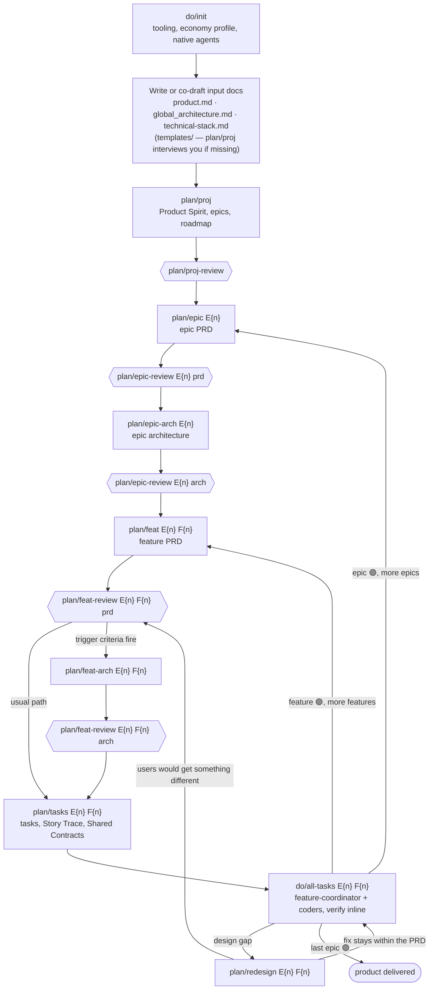

# plan-doc-do-follow Skill

A comprehensive product development workflow: **Plan** your product → **Doc**ument specifications → **Do** the work → **Follow** up with verification

Structured planning with built-in business reviews, single-source-of-truth status tracking, scope-change management, and clear routing from product vision to shipped features. Project- and environment-agnostic: works for backend, frontend, fullstack, mobile, SaaS, or batch projects, in Claude Code, Cursor, GitHub Copilot, or any AI environment that reads skills

## Installation

### Cursor (project skill)

```bash
git submodule add git@github.com:codeAvecCyril/ia-skill-plan-doc-do-follow.git .claude/skills/plan-doc-do-follow
mkdir -p .cursor/skills/plan-doc-do-follow
```

Create `.cursor/skills/plan-doc-do-follow/SKILL.md` pointing to `.claude/skills/plan-doc-do-follow/SKILL.md`

### Cursor (personal skill)

```bash
git clone git@github.com:codeAvecCyril/ia-skill-plan-doc-do-follow.git ~/.cursor/skills/plan-doc-do-follow
```

### Claude Code (project skill)

```bash
git submodule add git@github.com:codeAvecCyril/ia-skill-plan-doc-do-follow.git .claude/skills/plan-doc-do-follow
```

### Project prerequisites

- `docs/product.md` — product vision (template with examples: `templates/product.md`; `plan/proj` offers to draft it with you)
- `docs/global_architecture.md` — system architecture (template with examples, arc42/C4-inspired: `templates/global_architecture.md`)
- `docs/technical-stack.md` — technologies, versions, commands, conventions (template with examples: `templates/technical-stack.md`)
- A repository instruction file, whichever your environment uses: `CLAUDE.md`, `AGENTS.md`, `.github/copilot-instructions.md`, or `.cursor/rules/` (optional)

## Design principles

- **One fact, one file.** Each status is written in exactly one owning table: task status in `feat-tasks.md`, feature status in `epic-status.md`, epic status in `docs/project-status.md`. No `feat-status.md` file, no per-task status lines, no duplicated legends. Nothing to keep in sync means nothing drifts
- **Status Sync.** One deterministic, idempotent procedure recomputes every level bottom-up from document reality. Every status-changing route ends with it, and `do/sync-status` repairs any drift on demand
- **Epic-first architecture.** The epic architecture is the real design level. Features carry a short "Architecture Delta" in their PRD; a dedicated `feat-arch.md` exists only when explicit trigger criteria fire (new integration, new entity, new component, new security surface)
- **Living global docs.** `docs/data-model.md` (schema truth), `docs/ui-map.md` (navigation truth), and `docs/design-guidelines.md` (style contract) are updated in the same change that affects them — `do/verify` enforces the data and UI gates
- **Reviews built for humans.** The AI auto-verifies mechanical checks and collapses them to one line; the human answers at most 10 decision items per review. Every item follows one mandatory format from `guides/review-questions.md`, whatever the model: the business situation first, plain words (technical names confined to an optional line for the tech lead), the concrete impact of each possible answer, a recommendation, and an explicit bold **Confirm?** question — with good and bad examples. Answers are applied straight into the reviewed PRD or architecture, which carries the decision from then on; the review file keeps the question and the answer verbatim. There is no separate decision log: in practice it grew into an unread dump, and the approved documents are the binding record. The AI↔critic deliberation stays internal — review documents and handoffs show only the final result and what the human must validate
- **Product Spirit.** A 5–10 sentence distillation of the product's identity sits at the top of `project-status.md` and is injected into every planning route and reviewer, so the vision never dissolves into generic AI knowledge
- **Model tiering.** Planning routes and reviewers assume a strong model; `plan/tasks` produces tasks a weaker model can execute without opening the PRD, verified by a self-containment check
- **Bundled scripts.** Deterministic document work is never re-derived by the model: `scripts/pddf.py` (Python standard library only) runs Status Sync, updates one task row and the live Execution line, computes waves, prints a single task packet, lint-checks task breakdowns (missing sections, paths, validation commands, references to other documents, Story Trace coverage, dependency cycles), reads or replaces one Markdown section, and lists unanswered review items. The script's code never enters the model's context, only its few lines of output, and the same input always gives the same result. It refuses to downgrade a verified 🟢 feature on its own: stale task rows and work appended after verification look identical in the tables, so it reports a `REVIEW` item and lets the route decide
- **Token economy.** `SKILL.md` is a thin router; each route's playbook loads on demand from `routes/`; document scaffolds load from `templates/`; subagent definitions load on demand from `subagents/` with scoped inputs, not "read everything"; execution subagents get self-contained task packets. A **Working Economy** section governs the rest: LSP-first navigation and CLI output filters on the input side (`do/init` sets them up), **inline-first spawn gates** (prefer principal scout-lite over spawning `repo-scout` when context already holds the answer), Tooling injection into every subagent brief, return-payload caps, a per-project **Subagent economy** profile (`strict` | `balanced` | `quality`) stored in the repo instruction file Tooling section, caveman-concise agent output and agent-facing docs, a minimal-implementation ladder for all coding, and process-free documents whose changelogs record milestones only. Since 3.8 it also covers prompt-cache hygiene (stable prefixes, identical heads for parallel briefs, no mid-task model switch), fewer and fuller turns, a lean tool surface (unused MCP servers cost tool definitions on every turn), compaction only at natural breaks, instruction files under about 5k tokens, packets passed by reference instead of retyped (output tokens cost several times input tokens), and one yardstick for all of it: cost per *successful* task, since compression that triggers extra turns or retries costs more than it saves. Agent-facing files stay instruction-dense — rationale lives here in the README, for humans
- **Changelog hard rule.** Status-doc changelogs are milestone journals, not activity logs: one line per entry (≤25 words), and only for epic completion / feature verification / scope changes / migration. Everything else — task generation, PRD drafts and approvals, execution waves, critic exchanges — lives in git history and the owning status tables. The rule exists because models copy the style of whatever entries a document already contains; the templates and live docs carry a guard comment, and existing verbose entries are explicitly declared non-precedent
- **Story continuity.** Inspired by an old rule of thumb: to prove a solution, tell its story from start to finish — trace every process and data flow until the user receives exactly what they expect, both in the processing logic and on the screen. `plan/tasks` tells each user story before splitting it, records the result as a **Story Trace** (acceptance criterion → hop chain → tasks) and **Shared Contracts** (every interface between tasks defined once), replays each story through the task texts in self-review, and the task-checker verifies the chain. `do/verify` walks the implemented stories the same way
- **Coordinated, plan-faithful execution.** `do/all-tasks` is run by a **feature-coordinator** — a role the principal session adopts (it is not spawned, because most platforms forbid subagents from spawning subagents). It dispatches feature-coders, reviews each diff before accepting it, updates the Task Summary row the moment a task is accepted (with a live `Execution: done/total · wave · ETA` line), and reports progress after every wave without asking "continue?". Coders run at medium thinking and treat the plan as a contract: taste disagreements are not even reported, coder questions never reach the user, and the coordinator triages every escalation as *follow the plan*, *fix the packet*, or *redesign*
- **Clean redesign path.** When execution proves the plan cannot work as written (evidence required), the coordinator records a Design Gap and `plan/redesign` re-plans holistically on a strong model: it re-tells every impacted story, fixes the design once, amends pending tasks and appends corrective tasks, and re-runs the task-checker. If users would get something different from the PRD, it asks the product owner through the review format instead of improvising
- **Subagent economy.** Every prospective spawn runs an ordered inline-first gate (facts in context → ≤5 local tool calls → brief too big → cosmetic → else spawn). `repo-scout` has a stricter bar and a scout-lite checklist the principal can run themselves. Spawned agents receive the Tooling one-liner (`rtk`/LSP/economy profile), question/tool caps, and return-size caps (scout ≤15 lines, critics ≤25). Profile lives in the repo **Tooling** section. `do/init` can optionally install/sync platform-native agents (Cursor, Claude Code, GitHub Copilot, OpenCode) from portable defs with critic/standard model tiers and a per-platform translation of the thinking level. Critics still converge by contract: one run per document, one scoped re-run maximum on blocking findings, never a third

## 18 Routes, 2 Phases

**Plan Phase**:
- `plan/proj` — Extract epics from product vision, bootstrap living docs
- `plan/proj-review` — Validate epics
- `plan/epic` — Create epic PRD
- `plan/epic-review` — Validate epic PRD or architecture
- `plan/epic-arch` — Design epic architecture
- `plan/feat` — Create feature PRD (with Entry Points and Architecture Delta)
- `plan/feat-review` — Validate feature PRD or architecture
- `plan/feat-arch` — Design feature architecture (exception cases only)
- `plan/tasks` — Break into self-contained tasks that tell every story end to end
- `plan/redesign` — Close a design gap found during execution with one holistic re-plan
- `plan/change` — Scope change: add or update a feature/epic, **including on an already implemented epic**
- `plan/migrate` — One-shot migration of a v2-documented project to the v3 structure

**Do Phase**:
- `do/init` — Set up token-saving tooling once per project (LSP, CLI filters like `rtk`/`snip`, `ast-grep`, skill scripts check, MCP tool-surface audit, Subagent economy profile, optional native agent install/sync for Cursor, Claude Code, Copilot, OpenCode, optional code-graph index)
- `do/task` — Implement a task
- `do/all-tasks` — Feature-coordinator runs all feature tasks in parallel waves, keeps statuses live, then runs the verification gates inline (no separate `do/verify` pass)
- `do/verify` — Verify completion when tasks were run one at a time (the verification gates are the only path to 🟢 DONE)
- `do/sync-status` — Recompute all statuses from reality, repair drift
- `do/memorize` — Document patterns and best practices

## Subagents

Defined in `subagents/` — one portable Markdown + YAML-frontmatter file per agent, each with a scoped input list, an output contract, and advisory `model_class` / `thinking` / `capabilities` hints (never a vendor model id — see `subagents/README.md` for the format and the mapping to Cursor, Claude Code, GitHub Copilot, and OpenCode native registries):

- **repo-scout** — read-only codebase researcher; grounds plans in what actually exists; Grep/Glob/LSP-first with tool/return caps; principal uses scout-lite when inline-first says so
- **prd-critic** — vision fit, differentiating vs unnecessary features, user journey, clarity of sentences
- **arch-critic** — data-path validity, global-architecture fit, alternatives, simplification
- **perf-critic-backend / perf-critic-frontend** — conditional performance reviews at design time and verify time, invoked only when their trigger criteria fire (unbounded data, hot request paths, large lists, real-time flows, explicit NFRs)
- **task-checker** — every task executable without opening the PRD, and every story unbroken across tasks; fails only what would actually block execution or break a story, capped at two runs after the author's self-review (runs at `plan/tasks` and `plan/redesign`)
- **feature-coordinator** — principal role for `do/all-tasks`: plan fidelity, diff review, live status, user feedback, redesign triage (adopted, never spawned or installed natively)
- **feature-coder** — executes one self-contained task packet per instance at medium thinking, follows the plan without redesigning it (runs in `do/all-tasks` waves)
- **ui-consistency-reviewer** — entry point reachable, style/terminology/states consistent with the design guidelines (runs at the verification gates for UI features with a non-trivial surface; small surfaces are checked inline)
- **doc-coherence-reviewer** — statuses, living docs, and links match reality (runs at epic completion, after `plan/change`, after `plan/migrate`)

Each route also opens with a one-line **Mindset** that specializes the principal agent (product strategist, staff architect, orchestrator, skeptical QA gatekeeper, …) without any platform-specific model switching

## Skill Layout

```
plan-doc-do-follow/
├── SKILL.md            ← thin router: routes, invariants, Status Model, Working Economy
├── routes/             ← one playbook per route, loaded on demand
├── subagents/          ← portable agent definitions (+ feature-coordinator principal role)
├── templates/          ← scaffolds named after the files they produce (incl. product, architecture, stack)
├── guides/             ← writing guides loaded on demand (review questions)
└── scripts/pddf.py     ← deterministic helpers (python3 scripts/pddf.py --help)
```

## Output Files

```
docs/
├── project-status.md          ← Product Spirit + epic statuses (owning table)
├── project-review.md
├── data-model.md              ← global schema truth (living)
├── ui-map.md                  ← global navigation truth (living, UI projects)
├── design-guidelines.md       ← UI style contract (living, UI projects)
├── patterns/                  ← from do/memorize
└── epics/e{n}-{epic-name}/
    ├── epic-brief.md
    ├── epic-prd.md
    ├── epic-status.md         ← feature statuses (owning table)
    ├── epic-arch.md
    ├── epic-review.md
    └── f{n}-{feat-name}/      ← direct child of the epic (no intermediate features/ directory)
        ├── feat-prd.md        ← includes Entry Points & Architecture Delta
        ├── feat-arch.md       ← exception cases only
        ├── feat-tasks.md      ← task statuses (owning table), Story Trace, Shared Contracts, Design Gaps
        └── feat-review.md
```

## Status Tracking

| Status | Emoji | Meaning                    |
| ------ | ----- | -------------------------- |
| TODO   | ⚪    | Not started                |
| SPEC   | 🟡    | Specified                  |
| PLAN   | 🟣    | Tasks generated            |
| DEV    | 🔵    | Implementation in progress |
| DONE   | 🟢    | Verified complete          |

Statuses are **derived, not maintained**: the Status Model in `SKILL.md` defines how each level is computed from the level below, and Status Sync applies it

## From Scratch to Shipped — Route Map

Hexagons are the steps where **you** answer the review questions; everything else is run by the AI when you call the route



At any point: `plan/change` when scope changes (even on shipped work) · `do/sync-status` when statuses look wrong · `do/memorize` to record a lesson · `do/task` + `do/verify` instead of `do/all-tasks` to go one task at a time

## Typical Usage

**New project:** follow the route map above

**Implementation hit a hole in the plan:** the coordinator records a Design Gap → `plan/redesign` → `do/all-tasks` resumes

**New feature on a shipped epic:** `plan/change` (classifies, reopens statuses, routes to `plan/feat`)

**Changed my mind about an implemented feature:** `plan/change` (appends tasks, never rewrites history)

**Statuses look wrong:** `do/sync-status`

## Migrating from v2

Run `plan/migrate` once — it works even with epics and features half implemented. It consolidates task statuses from all the v2 locations into the owning tables (most-advanced-wins, with 🟢 spot-checked against the code), removes `feat-status.md` files, distills the Product Spirit block, bootstraps the living docs (reverse-engineering `docs/data-model.md` and `docs/ui-map.md` from the implemented code), runs Status Sync plus the Doc Coherence Reviewer, and hands you a migration report. Legacy PRDs are not rewritten: missing v3 sections are filled lazily the first time a route touches that feature

---

**Version**: 3.8 (3.7 plus: bundled `scripts/pddf.py`; Working Economy refreshed — cache, turns, tool surface, compaction, cost per successful task; route map; numbered acceptance criteria) · 3.7 (3.6 plus: `docs/decisions.md` removed — answers applied into reviewed docs; review-question writing guide with examples; feature-coordinator + `plan/redesign`; Story Trace and Shared Contracts in `plan/tasks`; medium-thinking feature-coder; `product.md`, `global_architecture.md`, `technical-stack.md` templates; thinking → effort mapping for Claude Code, Cursor, Copilot, OpenCode)

**License**: Apache-2.0 — see [LICENSE](LICENSE)

**The philosophy**: Plan well, document clearly, execute focused, follow up consistently. Build great products
