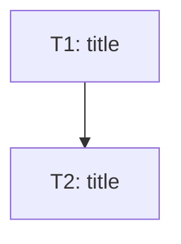

# Task Breakdown — {feature-name}

> **Feature**: F{n} — {feature-name}
>
> **Epic**: E{n} — {epic-name}
>
> **Last Updated**: {date}

<!-- Delete unused sections. Never write "N/A"
     Solo mode: omit Effort column -->

## Task Summary

<!-- OWNING TABLE: SINGLE source of truth for task status
     Per-task sections below carry NO status — update only this table
     do/all-tasks: row 🔵 at dispatch, 🟢 at acceptance, one row at a time
     Execution line: added by feature-coordinator during do/all-tasks, derived, removed when verified -->

**Execution**: {done}/{n} 🟢 ({pct}%) · wave {k}/{w} · ETA ~{eta}

| Code | Task    | Type                                        | Depends on | Status |
| ---- | ------- | ------------------------------------------- | ---------- | ------ |
| T1   | {title} | Database/Backend/API/Frontend/Test/Config   | —          | ⚪     |
| T2   | {title} | {type}                                      | T1         | ⚪     |

**Parallelizable**: {e.g. T2 and T3 independent}
**Critical path**: {e.g. T1 → T2 → T4}

## Dependency Graph (optional, decorative)

<!-- Regenerated from Task Summary table; never source of truth -->

## Story Trace

<!-- Each acceptance criterion, told start to finish: trigger → processing → stored data → screen → result promised
     Every hop owned by a task; unowned hop = design hole, close before handing off -->

| Criterion (verbatim) | Path: trigger → … → result user gets | Tasks |
| -------------------- | ------------------------------------ | ----- |
| {US-1 AC-2: "{quoted}"} | {e.g. click Save → `POST /api/plans` → `plans` row → `GET /api/plans` → list shows plan + "Saved" toast} | T2 → T3 → T5 |

## Shared Contracts

<!-- Every interface crossing tasks, defined ONCE, exact: names, shapes, units, timezone, null/empty behavior
     Tasks inline the lines they produce/consume; coordinator rejects any deviation -->

| Contract | Exact definition | Producer | Consumers |
| -------- | ---------------- | -------- | --------- |
| {e.g. `POST /api/plans`} | {e.g. body `{name: str 1–80, beds: int ≥1}` → 201 `{id: uuid, name, beds, created_at: ISO-8601 UTC}`; 422 on invalid} | T3 | T5, T7 |

---

## Task Details

<!-- Every task executable by weaker model WITHOUT opening PRD or any other doc:
     WHAT / WHERE / HOW / WHY / DONE all explicit -->

### T1: {title}

**Objective (WHAT/WHY)**: {one sentence: what built and why}
**Context**: {2–3 sentences: everything needed to work standalone}

**Files (WHERE)**:
- Create: `exact/path/to/file`
- Modify: `exact/path/to/file`

**Steps (HOW)**:
1. {concrete step}
2. {concrete step}

**Contracts**: {Shared Contract lines this task produces/consumes, copied exactly — delete if none}

**Pattern reference**: `docs/patterns/{pattern}.md` (if applies)

**Done when (DONE)**:
- [ ] {verifiable criterion}
- [ ] Tests: {what to test and how}
- [ ] Validation command(s): `{runnable command}`

**Notes**: {known pitfalls — delete if none}

---

### T2: {title}

{same structure}

---

## Design Gaps

<!-- Added by feature-coordinator only when execution proves plan cannot work as written; closed by plan/redesign
     G{n} · found in T{n} · plan says: {quote} · reality: {fact + evidence} · tasks likely impacted · open | closed {date}: {fix} → T{…} -->

## Blockers

- [ ] {blocker as complete sentence — delete section if none}

## Risks (optional)

| Risk | Likelihood | Impact | Mitigation |
| ---- | ---------- | ------ | ---------- |
